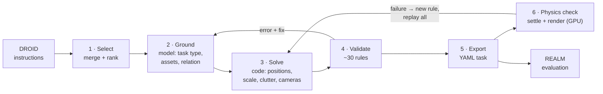

# REALM task authoring

**Turn a sentence like *"put the marker in the cup"* into a validated, physics-checked REALM benchmark task, automatically and reproducibly.**

[How it works](docs/how-it-works.md) · [Walkthrough](docs/walkthrough.md) · [Usage](docs/usage.md) · [Results](docs/results.md) · [Reference](docs/reference.md) · [Limitations](docs/limitations.md)

<picture>
  <source media="(prefers-color-scheme: dark)" srcset="docs/assets/layouts-dark.svg">
  
</picture>

---

## Why

REALM measures how well robot policies generalise, but every task in it was built by hand: choose the objects, place them, check they don't fall over, pick cameras. That doesn't scale past a handful of tasks.

This tool builds tasks from the most common instructions in **DROID**, a large dataset of real robot demonstrations, so the benchmark tests what robots are actually asked to do. A language model handles the meaning of each instruction. Deterministic code handles all the geometry, so every task can be rebuilt exactly and checked rule by rule.

## At a glance

| | |
|---|---|
| DROID instructions read | **2,080** unique, merged into **374** task clusters |
| Processed by the generator | **227** |
| Tasks produced | **104**, across 4 task types and 6 tabletops in 4 REALM scenes |
| Declined, with a written reason | **113** (e.g. *"no lid in the catalogue fits a bottle neck"*) |
| Pass host validation | **104 / 104** |
| GPU needed for generation | **no**, only for the final physics check and evaluation |

## How it works



> **The model decides what the task means. Code decides where everything goes.**
> No tool the model can call accepts a coordinate, so every number in a task comes from one seeded solver. When no real asset fits, the model declines and records why, instead of substituting something wrong.

Read the full explanation in [How it works](docs/how-it-works.md), or follow one instruction through every step in the [Walkthrough](docs/walkthrough.md).

## Quick start

From the repository root, on any laptop:

```sh
# once: build the asset catalogue (needs the BEHAVIOR-1K dataset, not a GPU)
python -m tooling.task_authoring.agent.catalog build --dataset "$REALM_DATA_PATH/datasets/behavior-1k-assets"

# try one instruction by hand
python -m tooling.task_authoring.agent.cli start "Put the marker in the cup" --ranking-id demo --rank 1
python -m tooling.task_authoring.agent.cli call <task_id> search_assets '{"query":"marker","role":"main"}'

# or let a coding agent do a batch: tell it
#   "Follow tooling/task_authoring/agent/GENERATE_TASKS.md for the next 20 instructions."

# write and check the task files
python -m tooling.task_authoring.agent.cli export
python -m tooling.task_authoring.validation realm/config/tasks/REALM_DROID100 --profile authored
```

Then, in the REALM container on a GPU, run the [physics check](docs/usage.md#run-the-physics-check-gpu) and [evaluate a policy](docs/usage.md#evaluate-a-policy-gpu). [Usage](docs/usage.md) covers every option, including [your own instructions](docs/usage.md#generate-tasks-from-your-own-instructions).

## Results

<picture>
  <source media="(prefers-color-scheme: dark)" srcset="docs/assets/outcomes-dark.svg">
  
</picture>

About half of the common DROID instructions become an honest REALM task. The rest are declined for reasons a reviewer can read: no suitable asset, a motion REALM can't score, several objects at once. More charts, the family's composition and the physics-check history are in [Results](docs/results.md).

## Documentation

| Page | Read it to… |
|---|---|
| [How it works](docs/how-it-works.md) | understand the data flow and every stage, with diagrams |
| [Walkthrough](docs/walkthrough.md) | see real inputs and outputs for one instruction |
| [Usage](docs/usage.md) | run the pipeline, on DROID or on your own sentences |
| [Results](docs/results.md) | see what the current family contains and how it was filtered |
| [Reference](docs/reference.md) | look up files, commands, task types and check codes |
| [Limitations](docs/limitations.md) | know what it can't do yet and what comes next |
| [Dashboard](docs/dashboard.md) | author a single task by hand in a 3D editor |

## Status

The pipeline generates and validates the `REALM_DROID100` family end to end. Still open: a full physics check of the current family, freezing it as a versioned release, and policy evaluation on it. See [What's next](docs/limitations.md#whats-next).
