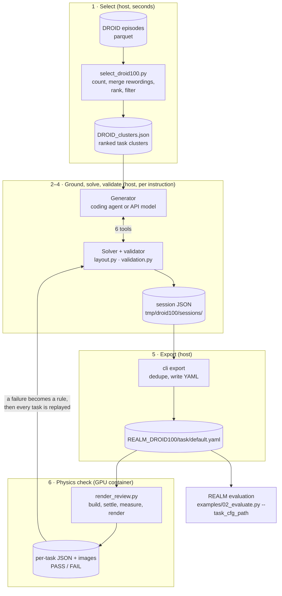
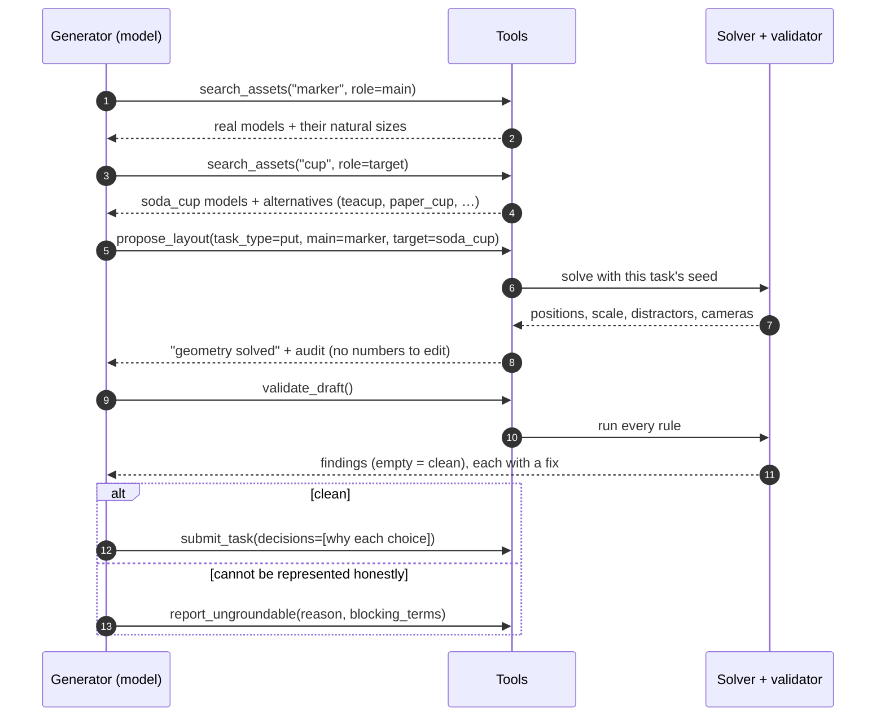
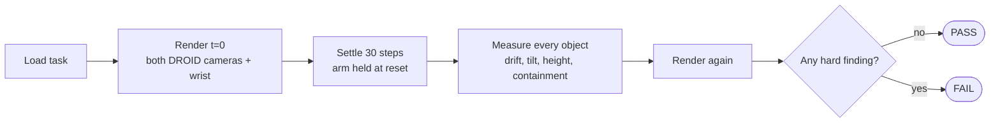

# How it works

[← Back to overview](../README.md) · **How it works** · [Walkthrough](walkthrough.md) · [Usage](usage.md) · [Results](results.md) · [Reference](reference.md) · [Limitations](limitations.md)

This page follows one batch of instructions from raw robot data to a task a policy can be evaluated on. Each stage says what goes in, what comes out, and where the output is written.

## The one rule everything follows

> **The model decides what the task means. Deterministic code decides where everything goes.**

| A language model may… | A language model may never… |
|---|---|
| choose the task type (`put`, `pick`, `stack`, `rotate`, …) | write a position, rotation or size |
| pick which real asset plays each role | scale an object |
| state a starting relation ("the marker starts *inside* the mug") | draw a random number |
| rewrite the instruction to name what is actually in the scene | edit a YAML file |
| decline the instruction and say why | override a validation error |

No tool the model can call has a parameter for a coordinate. Positions, orientations and scales all come from one seeded solver. That gives three properties a benchmark needs:

- **Reproducible.** The same instruction, catalogue and seed rebuild the same file, byte for byte.
- **Auditable.** Every number traces back to a rule in [`AUTHORING_RULES.md`](../AUTHORING_RULES.md), not to a model's guess.
- **Honest.** When no real asset fits, the model has an explicit way out (`report_ungroundable`) instead of quietly substituting something wrong.

## The whole pipeline



| Stage | Runs on | Input | Output |
|---|---|---|---|
| 1 Select | laptop | DROID parquet files | `tmp/droid100/DROID_clusters.json` |
| 2 Ground | laptop | one instruction | tool calls recorded in a session file |
| 3 Solve | laptop | roles + relation chosen by the model | positions, yaw, scale, distractors, cameras |
| 4 Validate | laptop | the solved draft | findings, each with a suggested fix |
| 5 Export | laptop | all submitted sessions | `realm/config/tasks/REALM_DROID100/*/default.yaml` |
| 6 Physics check | GPU container | each YAML | PASS/FAIL JSON, drift numbers, camera images |
| Evaluate | GPU container | YAML + a policy server | REALM success scores |

Everything up to stage 5 runs on a laptop with no GPU. Only stage 6 and evaluation need the simulator.

---

## Stage 1 · Select instructions

**Script:** [`select_droid100.py`](../select_droid100.py)

DROID is a large dataset of real robot demonstrations. Each episode was recorded together with up to three typed instructions (`language_instruction`, `_2`, `_3`), a success flag and a location. The selector:

1. reads every instruction from successful episodes,
2. merges rewordings of the same task into one **cluster** ("put the marker in the cup" and "put the marker in the mug" become one),
3. ranks clusters by how many **different locations** demonstrated them, then by successful episodes, so the list favours tasks that are common across labs rather than repeated in one,
4. filters out phrasings REALM cannot score, and records why.

The output keeps the most-demonstrated wording as `instruction` and the rest as `variants`:

```json
{"rank": 1, "instruction": "Remove the lid from the pot", "task_type": "pick",
 "episodes": 9, "locations": 7,
 "variants": ["Take the lid of the blue pot", "Remove the lid from the black pot", "..."]}
```

The filter is deliberately coarse. Anything it lets through is judged again, with more care, by the generator in stage 2.

## Stage 2 · Ground the instruction (the agent loop)

**Code:** [`agent/tools.py`](../agent/tools.py), [`agent/cli.py`](../agent/cli.py), [`agent/run.py`](../agent/run.py)
**Brief the generator follows:** [`agent/GENERATE_TASKS.md`](../agent/GENERATE_TASKS.md)

The generator is a language model working through six tools. It can be driven three ways, all with the same tools:

| Driver | Who calls the tools | Needs |
|---|---|---|
| `agent.cli` | an interactive coding agent, or a person, one shell command at a time | nothing extra |
| `agent.run --model <id>` | the Anthropic API, unattended | `ANTHROPIC_API_KEY` |
| `agent.run --offline` | a scripted keyword matcher (smoke test only) | nothing |



| Tool | What the model gets back |
|---|---|
| `search_assets` | real catalogue models for a noun, their sizes, and other categories the word could mean |
| `list_scene_regions` | the REALM tabletops a task can be placed on |
| `propose_layout` | runs the solver on the model's role choice; returns an audit, never editable numbers |
| `validate_draft` | coded findings, each with the exact fix to apply |
| `submit_task` | accepts the task, storing the model's `decisions` (why each choice was made) |
| `report_ungroundable` | records an honest decline with its reason |

The model's job is semantic: which task type, which assets, which relation, and whether the instruction must be rewritten. For example, "Pick up the white cup and move it to the left" becomes "Pick up the cup", because REALM cannot score "to the left" and the asset's colour is fixed by its texture.

## Stage 3 · Solve the geometry

**Code:** [`agent/layout.py`](../agent/layout.py), which calls the placement functions in [`generate_realm_droid100.py`](../generate_realm_droid100.py)

Given the model's roles, the solver produces every number in the config:

- **Table:** picks one of six REALM tabletop regions from the task's own seed, which spreads the family across scenes.
- **Placement:** packs objects collision-free, at least 2.5 cm inside the table edge.
- **Height:** starts each object **1.5 cm above the measured table surface**, so it settles instead of dropping.
- **Size and rotation:** keeps natural sizes; when something must shrink it uses **one uniform scale**, and rotations are **yaw only** (0° or 90°).
- **Containers:** a `put` receiver must cover the object's footprint ×1.15, a `stack` support at least 65% of it. A lid must be at least as wide as the pot opening, a plate resting on a bowl must overhang its rim by 1.5 cm a side, and an object starting inside a container must stick out far enough to grasp. Pens go into mugs upright.
- **Clutter:** samples up to three distractors from a DROID-style whitelist, at most one per product family (`bottle_of_*`, `jar_of_*`, …), never the task's own categories.
- **Cameras:** draws a pair of DROID camera poses that look down at the workspace, from a separate random stream so clutter and cameras don't affect each other.

## Stage 4 · Validate

**Code:** [`validation.py`](../validation.py) (the rules of [`AUTHORING_RULES.md`](../AUTHORING_RULES.md) as executable checks)

The validator checks the solved draft against about 30 rules and blocks the task on any error. Findings are grouped roughly as:

| Group | Example codes | Catches |
|---|---|---|
| Schema | `SCHEMA_MISSING_KEY`, `UNKNOWN_KEY`, `NAME_DUPLICATE` | malformed configs, keys OmniGibson would silently ignore |
| Placement | `SUPPORT_PENETRATION`, `FLOATING_OBJECT`, `XY_OVERLAP`, `SUPPORT_CONTAINMENT` | objects inside the table, in the air, inside each other, off the edge |
| Physical sense | `RECEIVER_CAPACITY`, `LID_SMALLER_THAN_OPENING`, `RIM_OVERHANG`, `RELATION_UNGRASPABLE`, `UPRIGHT_DISTRACTOR` | containers too small, objects that can't be grasped, bottles on their side |
| Task logic | `GOAL_SATISFIED_AT_START`, `TARGET_STATE_RUBRIC`, `RELATION_UNGROUNDED` | tasks that start already solved, or promise something the rubric can't score |
| Language | `INSTRUCTION_PHANTOM_OBJECT`, `INSTRUCTION_CLOSURE`, `INSTRUCTION_GROUNDING` | the sentence names an object the scene does not contain |

Every finding carries a `fix` field telling the model exactly what to change, so the model never has to do arithmetic. See the [walkthrough](walkthrough.md#a-validation-error-and-its-fix) for a real one.

## Stage 5 · Export

`python -m tooling.task_authoring.agent.cli export` turns all submitted sessions into task folders:

- tasks that solve to the same config ("marker in the cup" / "marker in the mug") are **collapsed into one**,
- each folder is named after the final instruction plus a short hash, e.g. `put_the_marker_in_the_cup_d31114/`,
- every YAML carries a `provenance` block: original DROID wording, task id, ranking id, prompt version, and the model's `decisions`.

## Stage 6 · Physics check

**Script:** [`render_review.py`](../render_review.py) (runs inside the REALM container on a GPU)

Arithmetic on bounding boxes cannot see mesh interiors, contact or balance, so each task is built in the real simulator:



| Finding | Meaning | Threshold | Fails the task? |
|---|---|---|---|
| `UNSTABLE` | a task object kept moving during the settle | > 3 cm | yes |
| `DRIFT` | small settle, or clutter shifting | 1–3 cm | warning |
| `TIPPED` | a receiver or fixture fell over | tilt > 35° | yes |
| `PENETRATION` | sunk into the table or floor | > 1.5 cm below the measured surface | yes |
| `LEFT_CONTAINER` / `LEFT_SUPPORT` | fell out of, or slid off, what it started in / on | 1 mm / 3 mm margins | yes |
| `MISSING` / `DROPPED` | object absent, or placement gave up | — | yes |
| `HIGH_DROP` | starts high enough that it may not land upright | > 6 cm above the surface | warning |

The verdict is written into the JSON file, because Isaac Sim exits with code 0 even after a crash. Read the JSON, never the exit code.

## Stage 7 · Fix the rule, replay everything

When the physics check fails a task, nobody hand-edits that one YAML. The cause becomes a rule in the solver or validator, and every submitted session is **replayed** through the updated code. Replay re-runs the model's last `propose_layout` choice, so the model's decisions are kept and only the geometry is recomputed.

Real examples from the git history:

| Problem seen in the renders | What changed in the code |
|---|---|
| objects fell 10–16 cm at spawn, because the scene file's `z` is a spawn plane, not the table top | table height measured per region (`MEASURED_SURFACE_BELOW_SPAWN_M`); objects start 1.5 cm above it |
| plates resting on bowls | flat objects are dropped in from the rim; new `RIM_OVERHANG` rule |
| objects starting inside containers were hard to reach | they must stick out above the rim (`RELATION_UNGRASPABLE`) |
| camera pairs that missed the table | pairs that don't look down at the workspace are redrawn |
| some asset models render broken | those models are never offered by `search_assets` |

A task that still can't pass becomes an honest decline with the render named in its reason ("Render v4: the knife tips the paper cup over during the settle").

## Determinism and provenance

| Mechanism | Effect |
|---|---|
| `task_id = sha1(instruction + "|" + ranking_id)[:12]` | a task keeps its identity when the ranking is rebuilt |
| one random stream per concern (scene, camera, distractors) | adding a draw in one place never shifts the others |
| cache keyed on task id, prompt version, model, catalogue fingerprint | a re-run makes no model calls and rewrites identical YAML; a bigger catalogue re-offers old declines |
| `PROMPT_VERSION`, bumped by hand when any prompt or tool text changes | a family made under a different prompt is visibly a different family |
| `provenance.decisions` in every YAML | a reviewer can read *why* each asset and wording was chosen |

## What is on disk

```text
tooling/task_authoring/
├── select_droid100.py           stage 1
├── agent/                       stages 2–5: tools, solver bridge, drivers, CLI
├── validation.py                stage 4 rules
├── render_review.py             stage 6 physics check
├── asset_catalog.json           built per machine, gitignored
└── docs/                        this documentation + make_figures.py

tmp/droid100/                    working state, gitignored
├── DROID_clusters.json          ranked clusters
├── sessions/<task_id>.json      one per instruction
└── interactive_report.json      export report: grounded / duplicate / declined

realm/config/tasks/REALM_DROID100/<task>/default.yaml   the generated family (gitignored)
```
