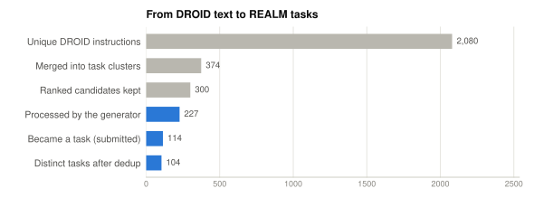
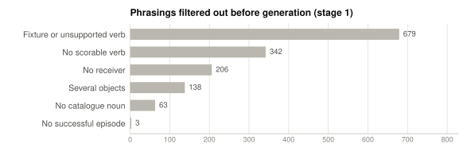
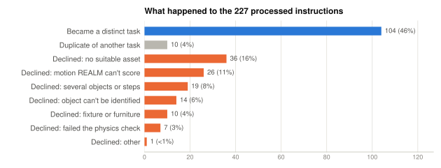
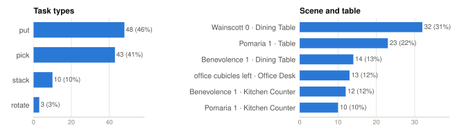
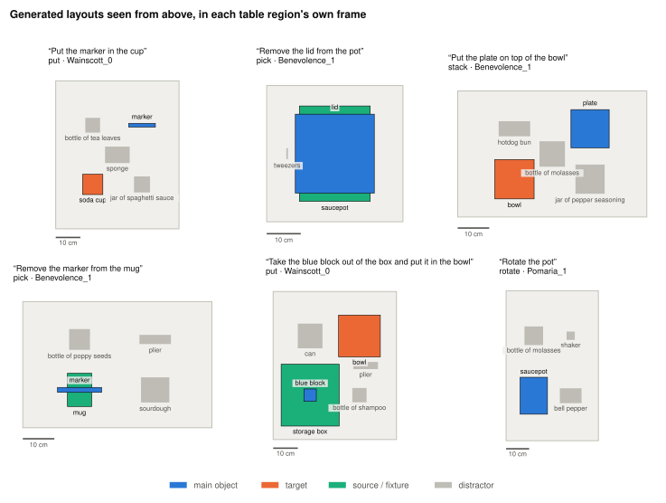

# Results

[← Back to overview](../README.md) · [How it works](how-it-works.md) · [Walkthrough](walkthrough.md) · [Usage](usage.md) · **Results** · [Reference](reference.md) · [Limitations](limitations.md)

State of the `REALM_DROID100` family as of **2026-10-17**: one DROID data chunk, prompt version 1, asset catalogue `e9664164e18d` (2,430 categories, 9,589 models). Every chart below is regenerated by [`make_figures.py`](make_figures.py) from the pipeline's own output files.

## Headline numbers

| | |
|---|---|
| Unique DROID instructions read | **2,080** (1,000 episodes, 838 successful) |
| Task clusters after merging rewordings | **374** |
| Instructions processed by the generator | **227** |
| Distinct tasks produced | **104** (46% of processed) |
| Honest declines, each with a written reason | **113** (50%) |
| Tasks passing host validation | **104 / 104** |
| Final instructions reworded from the DROID original | **88 / 104**, reason recorded every time |

## From DROID text to tasks

<picture>
  <source media="(prefers-color-scheme: dark)" srcset="assets/funnel-dark.svg">
  
</picture>

Most of the narrowing happens before any model is involved. Merging rewordings turns 2,080 phrasings into 374 tasks, and the cheap filter in stage 1 removes phrasings REALM could never score:

<picture>
  <source media="(prefers-color-scheme: dark)" srcset="assets/selection-filter-dark.svg">
  
</picture>

## What happened to each processed instruction

<picture>
  <source media="(prefers-color-scheme: dark)" srcset="assets/outcomes-dark.svg">
  
</picture>

About half of the common DROID instructions can be turned into an honest REALM task. The declines are not errors; they are the generator refusing to produce a task that would measure the wrong thing. Typical reasons, quoted from the run:

| Category | Example instruction | Recorded reason (abridged) |
|---|---|---|
| No suitable asset | Remove the black lid from the bottle | catalogue bottles carry their cap in the mesh, and the smallest lid is 7.6 cm |
| Motion REALM can't score | Push the green towel slightly to the right | the push rubric scores pressing a switch, not sliding an object |
| Several objects or steps | Put the ropes in the basket | plural main object, and the only rope asset is 2.1 m long |
| Object can't be identified | Put the metal object with the orange handle in the cup | identified only by material and colour |
| Fixture or furniture | Put the orange cup on the middle shelf | a bookcase shelf is not on any REALM tabletop |
| Failed the physics check | Remove the knife from the cup | in the render, the knife tips the light paper cup over and slides out |

The categories are assigned by keyword rules in `make_figures.py` from the free-text reasons, so they are an approximate grouping. The reasons themselves are in `tmp/droid100/interactive_report.json`.

## What the family contains

<picture>
  <source media="(prefers-color-scheme: dark)" srcset="assets/family-composition-dark.svg">
  
</picture>

- **51 different main objects.** The most frequent are lids and markers (9 tasks each), towels and water bottles (7), and pens (6). This mirrors what DROID operators actually did.
- **42 tasks start with a relation** ("the lid starts on the pot", "the marker starts in the mug"), using a source object that stays in the scene.
- **8 tasks use coloured primitive blocks.** These are the only objects whose colour can be guaranteed, so they are the only ones allowed to keep a colour word.
- **Clutter is varied:** 291 distractor placements use 142 different categories. No category appears more than 9 times, and 91 of the 104 tasks have three distractors.

## What the scenes look like

<picture>
  <source media="(prefers-color-scheme: dark)" srcset="assets/layouts-dark.svg">
  
</picture>

These are drawn directly from the YAML files: each rectangle is an object's footprint at its solved position and yaw, inside the table region. Objects that start inside or on top of another (the lid on the pot, the marker in the mug, the block in the box) overlap their container, as intended.

## Physics check

The physics check runs on the GPU machine, and its per-task results are not stored in this repository. To add the chart to this page, run:

```sh
python3 tooling/task_authoring/docs/make_figures.py --render-dir <folder with render_review JSON files>
```

What is known so far:

- **Render v3** (before the spawn-height fix) passed **81 of 103** tasks. Most of the 22 failures were objects falling 10–16 cm at spawn, because the scene file's height is a spawn plane, not the table top.
- That led to measuring the table height per region and starting every object 1.5 cm above it (see [How it works → Stage 7](how-it-works.md#stage-7--fix-the-rule-replay-everything)).
- After the later renders (v4 onwards), 7 instructions whose objects still tipped, sank or left the camera view were turned into declines, with the render named in the reason. The checks themselves were then tightened (direct containment and tipping checks, a 1 mm through-the-floor threshold).

A full render of the current family is the next measurement to take. See [Limitations → What's next](limitations.md#whats-next).
